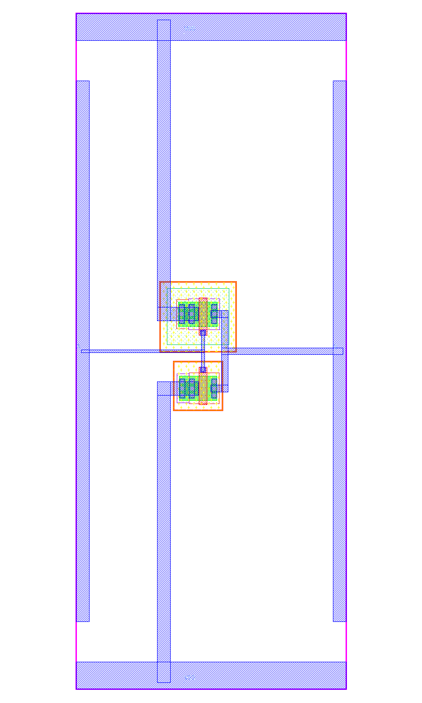
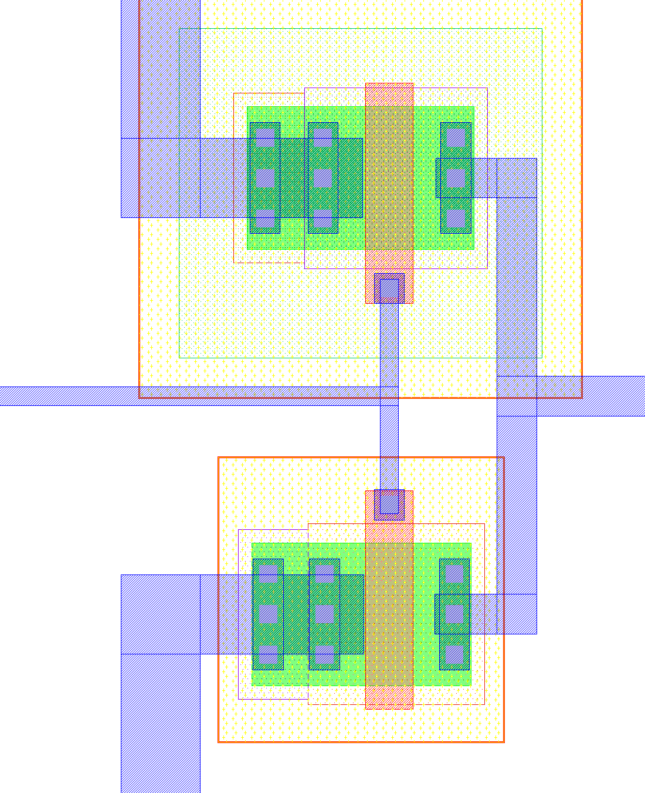

# inv_dut_096

5.0 V CMOS inverter for RISC-V Day MPW, using the assigned parameters in
[`dut_params.csv`](../dut_params.csv) and the supplied
[`LVS/inv_dut_096.cdl`](../LVS/inv_dut_096.cdl).

## Devices

| Device | Model | W | L | Fingers | Multiplier |
| --- | --- | --- | --- | --- | --- |
| PMOS | `pfet_05v0` | 1.80 µm | 0.60 µm | 1 | 1 |
| NMOS | `nfet_05v0` | 1.80 µm | 0.60 µm | 1 | 1 |

The assigned dimensions are preserved. A drives both gates; Q joins both drains.
The PMOS source and well connect to VDD; the NMOS source and substrate connect
to VSS.

## Layout

- Submission: [`src/inv_dut_096.gds`](../src/inv_dut_096.gds).
- Single top cell: `inv_dut_096`; database unit: 0.001 µm.
- PR_BNDRY: 20 × 50 µm, centered at the origin.
- Original M1 pin shapes and labels A, Q, VDD and VSS are preserved.
- Single-finger devices with adjacent body ties; each body tie uses three
  contacts. Routing uses Metal1; no inter-metal vias are required.
- Devices and signal branches are centered to shorten routing. This does not
  change device dimensions or materially improve 40 pF drive capability.





## Verification and reproduction

Use KLayout 0.30.9 or newer, Python with `pyyaml`, `click` and KLayout's `pya`
bindings, and `ishi-kai/gf180mcuD` at ref `RD_2611`. From the repository root:

```sh
scripts/run_local.sh /path/to/gf180mcuD
```

The script writes reports to `run/` and runs the same checks as GitHub Actions:

| Check | Result |
| --- | --- |
| Pre-check: filename, single top cell, database unit | Pass |
| DRC: `all,-density,inv_dut` | 0 violations |
| LVS against the supplied `LVS/inv_dut_096.cdl` | Match |

PDK variant: gf180mcuD, 5LM, 11K top metal, MIM option B; LVS device
combination is enabled. PDK commit used locally:
`5d1b86ef9ab7470453c2b31899b3c244136aa029`.

Submitted GDS SHA-256:
`6d7976024b7d806e56389dff34265049173b0bb995711c065c55d13b2c9c6248`.

Density is excluded by the workshop's check flow. These results do not certify
full-chip integration or completion of every manual foundry rule.

## Simulation notes

The working design was also simulated locally at 5.0 V. With a 40 pF output
load, typical models at 27 °C, and 100 ps input edges, the schematic gives
tPHL = 111.267 ns and tPLH = 298.455 ns. These values exclude layout parasitics.

A separate Magic RC extraction was checked at five model corners and three
temperatures (-40, 27 and 125 °C). For a 40 pF load and 50% input duty cycle,
the typical 27 °C case passes at 722.980 kHz and fails at 729.512 kHz. The
lowest passing bound among the 15 tested cases is 473.732 kHz (SS, 125 °C).
The criterion requires VOL ≤ 0.5 V and VOH ≥ 4.5 V near the end of each half
cycle for three settled cycles. These are simulated bounds, not measured
silicon limits or a foundry timing sign-off.

## Author and license

- GitHub: [kastr0419](https://github.com/kastr0419)
- License: Apache-2.0, following the repository [LICENSE](../LICENSE).
